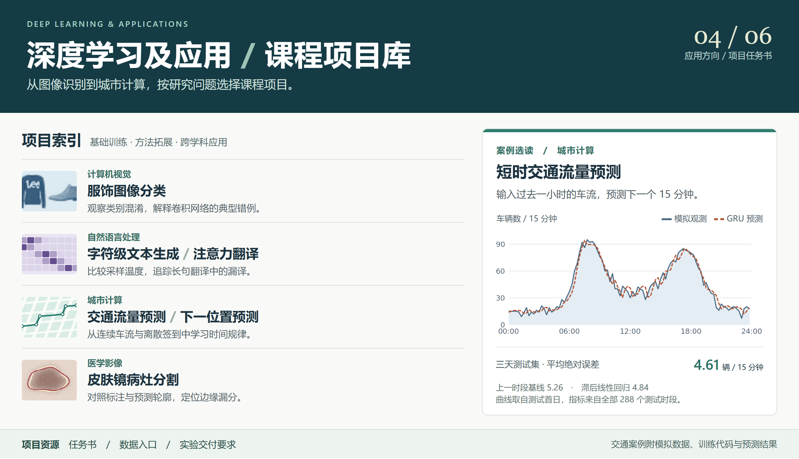

# 《深度学习及应用》课程项目库

## 选择一个研究问题

| 方向 | 课程项目 | 层次 | 交付物 |
| --- | --- | --- | --- |
| 计算机视觉 | [图像分类与错例分析](projects/fashion/README.md) | 基础 | 混淆矩阵、六张错例及模型对照表 |
| 自然语言处理 | [字符级文本生成](projects/generation/README.md) | 基础 | 同提示词三组续文、验证损失和重复片段标注 |
| 自然语言处理 | [注意力机制与机器翻译](projects/translation/README.md) | 拓展 | 长短句对照、注意力热力图和一例漏译分析 |
| 城市计算 | [短时交通流量预测](projects/traffic/README.md) | 拓展 | 分时段曲线、三模型误差表和一次高峰复盘 |
| 城市计算 | [基于签到序列的下一位置预测](projects/mobility/README.md) | 创新 | 轨迹示意图、三个候选地点和分组命中率 |
| 医学影像 | [皮肤镜图像病灶分割](projects/lesion/README.md) | 创新 | 原图与双轮廓叠图、逐图 Dice 分布及错例说明 |

## 先运行一个案例

[短时交通流量预测案例包](cases/traffic/README.md)包含 21 天模拟数据、两个基线、一个 GRU、运行说明和逐时段预测结果。用同一组测试数据复核平均绝对误差，再观察早高峰附近的预测偏差。

## 学习资源与配图

[公开课程与开源学习资源](resources/README.md)　·　[下载后打开独立首页](index.html)

服饰缩略图取自 [Fashion-MNIST](https://github.com/zalandoresearch/fashion-mnist)。注意力权重、位置轨迹和病灶轮廓为教学示意图。交通预测图由仓库中的程序在模拟数据上生成。
